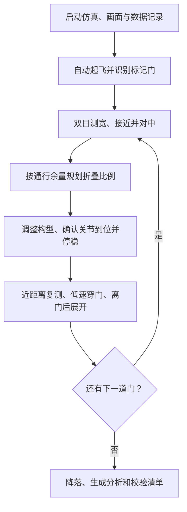

# 可折叠四旋翼：双目自动通行仿真

基于 PX4 SITL、Gazebo Harmonic 和 ROS 2 Humble，实现单舵机同步折叠四臂、
双目识别标记门宽度、自动选择折叠比例并穿越，支持 Gazebo 三维视角、RViz2 双目预览和按次保存数据。

`main` 是完整项目入口，包含 PX4 源码、机型、自动化工具、流程说明和验证归档。
Gazebo 模型通过 `Tools/simulation/gz` 子模块固定版本，来源为同仓库的 `gz-models` 分支。
`px4-transform-quad` 保留此前阶段版本。根目录 `airframes/`、`models/` 和 `px4/`
保留早期独立文件快照；当前开发和运行使用 `ROMFS/`、`src/` 与 `Tools/simulation/gz/`。

## 1. 获取完整项目

```bash
git clone --recurse-submodules --branch main \
  https://github.com/Cosmo-zh/transform_quad_simulation.git
cd transform_quad_simulation
```

更新已有的 `main` 工作副本：

```bash
git pull --ff-only origin main
git submodule update --init --recursive
```

新克隆仓库的远程名为 `origin`；本机开发目录的个人远程名为 `github`，
该目录的拉取命令相应使用 `git pull --ff-only github main`。

## 2. 准备环境

已验证环境为 Ubuntu 22.04、Gazebo Harmonic、ROS 2 Humble、Python 3.10。
现有开发电脑已经完成环境安装；新电脑先安装 PX4 仿真开发依赖：

```bash
bash Tools/setup/ubuntu.sh --no-nuttx
```

ROS 2 Humble 的软件源配置和基础安装参照
[ROS 官方 Ubuntu 安装说明](https://docs.ros.org/en/humble/Installation/Ubuntu-Install-Debs.html)。
配置好 ROS 与 Gazebo 软件源后，安装显示和 Python 桥接依赖：

```bash
sudo apt-get install ros-humble-rviz2 ros-humble-rclpy ros-humble-sensor-msgs \
  python3-gz-transport13 python3-gz-msgs10 python3-pexpect

python3 -m pip install --target logs/transform_stereo_deps --no-deps \
  opencv-python-headless==4.11.0.86
```

PX4 环境脚本安装 NumPy、pymavlink、matplotlib、pyulog 等公共依赖；
OpenCV 独立放在 `logs/transform_stereo_deps/`，启动器会自动加载。
RViz 桥接使用系统 `/usr/bin/python3` 和 `/opt/ros/humble/setup.bash`。
更多参数见 [可视化与数据保存说明](validation/transform_stereo_visualization.md)。

## 3. 编译并分步检查

以下命令均在仓库根目录执行。模型与世界已经提交，正常启动无需重新生成。
完整启动参数可用 `python3 Tools/transform_stereo_sitl_check.py --help` 查看。

```bash
make px4_sitl_default -j2

# 固定基座机构测试：验证四臂同步全行程，不启动 PX4
python3 Tools/transform_stereo_mechanism_check.py

# 静态双目与 RViz 预览，不解锁飞行
python3 Tools/transform_stereo_sitl_check.py --rviz

# 悬停、87.5% 折叠、展开、降落，不穿门
python3 Tools/transform_stereo_sitl_check.py --fold-check
```

按顺序执行并等待上一个命令结束；结果写入 `logs/transform_stereo/`。

## 4. 一条命令运行完整图形仿真

在桌面终端执行：

```bash
python3 Tools/transform_stereo_sitl_check.py --flight --rviz
```

该命令启动独立的 5103 SITL、Gazebo 三维跟随视角、RViz 左右相机画面和本次数据记录。
图形模式默认半速运行，RViz 以 5 Hz、480×300 预览；感知仍使用原始 960×600 双目图像。



当前训练场景有 600/440 mm 两道门。双目图像负责测宽、定位和对中，PX4 本地里程计
用于 Offboard 位置控制及近门短时不可见段。Gazebo 真值独立记录，仅用于事后验收。
视觉或遥测过期、关节未到位、姿态或通行误差超限、门体接触均会触发中止处理。

其他运行方式：

```bash
# 仅 Gazebo 三维视角
python3 Tools/transform_stereo_sitl_check.py --flight --gui

# 后台自动飞行，同样保存数据
python3 Tools/transform_stereo_sitl_check.py --flight
```

## 5. 查看本次数据与结果

每次创建 `logs/transform_stereo/transform_stereo_日期_时间_微秒/`，终端会输出完整路径。

| 文件或目录 | 内容 |
| --- | --- |
| `result.json`、`run.json` | 通行判定、中止原因、运行参数及分析状态 |
| `log/`、`frames/` | PX4 ULog 和定时采样的原始双目图片 |
| `events.jsonl`、`ground_truth.jsonl` | 状态、测量、遥测及独立真值 |
| `vision.json`、`resources.jsonl`、`ros_images.json` | 视觉耗时、资源占用及图像显示统计 |
| `analysis/` | CSV、汇总与轨迹/高度/关节曲线 |
| `manifest.json` | 文件大小与 SHA-256 清单 |

可对某次运行重新生成分析：

```bash
python3 Tools/analyze_transform_stereo.py logs/transform_stereo/本次目录名
```

启动失败、中断和飞行失败均保留已有数据。`logs/` 属于本地实验数据，已被 Git 忽略；
仓库中的精选成功记录保存在 `validation/`。

## 6. 已验证结果与范围

2026-10-19 完整图形回归完成两门通行，第二门折叠 88.5%，之后展开并降落。
独立真值确认两次门洞内穿越；接触通道收到 2095 条消息，门体接触为 0。
控制循环最大间隔约 52 ms，ULog 无丢帧，保存 262 对双目图片。

当前结果覆盖带标记的 600/440 mm 门与理想双目。长期成功率、无标记通道、
原 360 mm 门和实物通行仍需进一步验证。

| 说明 | 入口 |
| --- | --- |
| 当前进展与机型索引 | [PROJECT_STATUS.md](PROJECT_STATUS.md) |
| 新增和修改汇总 | [PROJECT_CHANGES.md](PROJECT_CHANGES.md) |
| 双目算法与自动通行 | [双目通行说明](validation/transform_stereo_passage.md) |
| 显示、诊断、参数和数据格式 | [可视化与数据保存](validation/transform_stereo_visualization.md) |
| 最新完整回归与原始证据 | [2026-10-19 验证归档](validation/stereo_20261019_stability/README.md) |
| 折叠控制与实物配置 | [transform_control 模块](src/modules/transform_control/README.md) |

---

## PX4 上游说明

以下保留上游 PX4 的项目介绍、开发资源和许可证入口。

<p align="center">
  <a href="https://px4.io">
    
  </a>
</p>

<p align="center">
  <em>The autopilot stack the industry builds on.</em>
</p>

<p align="center">
  <a href="https://github.com/PX4/PX4-Autopilot/releases"></a>
  <a href="https://www.bestpractices.dev/projects/6520"></a>
  <a href="https://zenodo.org/badge/latestdoi/22634/PX4/PX4-Autopilot"></a>
  <a href="https://github.com/PX4/PX4-Autopilot/actions/workflows/build_all_targets.yml"></a>
  <a href="https://discord.gg/dronecode"></a>
</p>

---

## About

PX4 is an open-source autopilot stack for drones and unmanned vehicles. It supports multirotors, fixed-wing, VTOL, rovers, and many more experimental platforms from racing quads to industrial survey aircraft. It runs on [NuttX](https://nuttx.apache.org/), Linux, and macOS. Licensed under [BSD 3-Clause](LICENSE).

## Why PX4

**Modular architecture.** PX4 is built around [uORB](https://docs.px4.io/main/en/middleware/uorb.html), a [DDS](https://docs.px4.io/main/en/middleware/uxrce_dds.html)-compatible publish/subscribe middleware. Modules are fully parallelized and thread safe. You can build custom configurations and trim what you don't need.

**Wide hardware support.** PX4 runs on a wide range of [autopilot boards](https://docs.px4.io/main/en/flight_controller/) and supports an extensive set of sensors, telemetry radios, and actuators through the [Pixhawk](https://pixhawk.org/) ecosystem.

**Developer friendly.** First-class support for [MAVLink](https://mavlink.io/) and [DDS / ROS 2](https://docs.px4.io/main/en/ros2/) integration. Comprehensive [SITL simulation](https://docs.px4.io/main/en/simulation/), hardware-in-the-loop testing, and [log analysis](https://docs.px4.io/main/en/log/flight_log_analysis.html) tools. An active developer community on [Discord](https://discord.gg/dronecode) and the [weekly dev call](https://docs.px4.io/main/en/contribute/).

**Vendor neutral governance.** PX4 is hosted under the [Dronecode Foundation](https://www.dronecode.org/), part of the Linux Foundation. Business-friendly BSD-3 license. No single vendor controls the roadmap.

## Supported Vehicles

<table>
  <tr>
    <td align="center">
      <a href="https://docs.px4.io/main/en/frames_multicopter/">
        <br>
        <sub>Multicopter</sub>
      </a>
    </td>
    <td align="center">
      <a href="https://docs.px4.io/main/en/frames_plane/">
        <br>
        <sub>Fixed Wing</sub>
      </a>
    </td>
    <td align="center">
      <a href="https://docs.px4.io/main/en/frames_vtol/">
        <br>
        <sub>VTOL</sub>
      </a>
    </td>
    <td align="center">
      <a href="https://docs.px4.io/main/en/frames_rover/">
        <br>
        <sub>Rover</sub>
      </a>
    </td>
  </tr>
</table>

<sub>…and many more: helicopters, autogyros, airships, submarines, boats, and other experimental platforms. These frames have basic support but are not part of the regular flight-test program. See the <a href="https://docs.px4.io/main/en/airframes/airframe_reference.html">full airframe reference</a>.</sub>

## Quick Start

```bash
git clone https://github.com/PX4/PX4-Autopilot.git --recursive
cd PX4-Autopilot
make px4_sitl
```

> [!NOTE]
> See the [Development Guide](https://docs.px4.io/main/en/development/development.html) for toolchain setup and build options.

## Documentation & Resources

| Resource | Description |
| --- | --- |
| [User Guide](https://docs.px4.io/main/en/) | Build, configure, and fly with PX4 |
| [Developer Guide](https://docs.px4.io/main/en/development/development.html) | Modify the flight stack, add peripherals, port to new hardware |
| [Airframe Reference](https://docs.px4.io/main/en/airframes/airframe_reference.html) | Full list of supported frames |
| [Autopilot Hardware](https://docs.px4.io/main/en/flight_controller/) | Compatible flight controllers |
| [Release Notes](https://docs.px4.io/main/en/releases/) | What's new in each release |
| [Contribution Guide](https://docs.px4.io/main/en/contribute/) | How to contribute to PX4 |

## Community

- **Weekly Dev Call** — open to all developers ([Dronecode calendar](https://www.dronecode.org/calendar/))
- **Discord** — [Join the Dronecode server](https://discord.gg/dronecode)
- **Discussion Forum** — [PX4 Discuss](https://discuss.px4.io/)
- **Maintainers** — see [`MAINTAINERS.md`](MAINTAINERS.md)
- **Contributor Stats** — [LFX Insights](https://insights.lfx.linuxfoundation.org/foundation/dronecode)

## Contributing

We welcome contributions of all kinds — bug reports, documentation, new features, and code reviews. Please read the [Contribution Guide](https://docs.px4.io/main/en/contribute/) to get started.

## Governance

The PX4 Autopilot project is hosted by the [Dronecode Foundation](https://www.dronecode.org/), a [Linux Foundation](https://www.linuxfoundation.org/) Collaborative Project. Dronecode holds all PX4 trademarks and serves as the project's legal guardian, ensuring vendor-neutral stewardship — no single company owns the name or controls the roadmap. The source code is licensed under the [BSD 3-Clause](LICENSE) license, so you are free to use, modify, and distribute it in your own projects.

<p align="center">
  <a href="https://www.dronecode.org/">
    
  </a>
</p>
